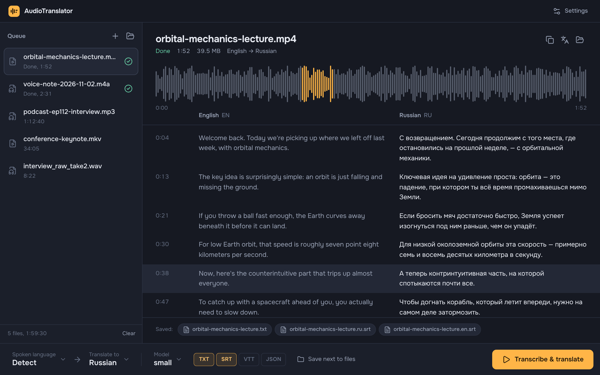
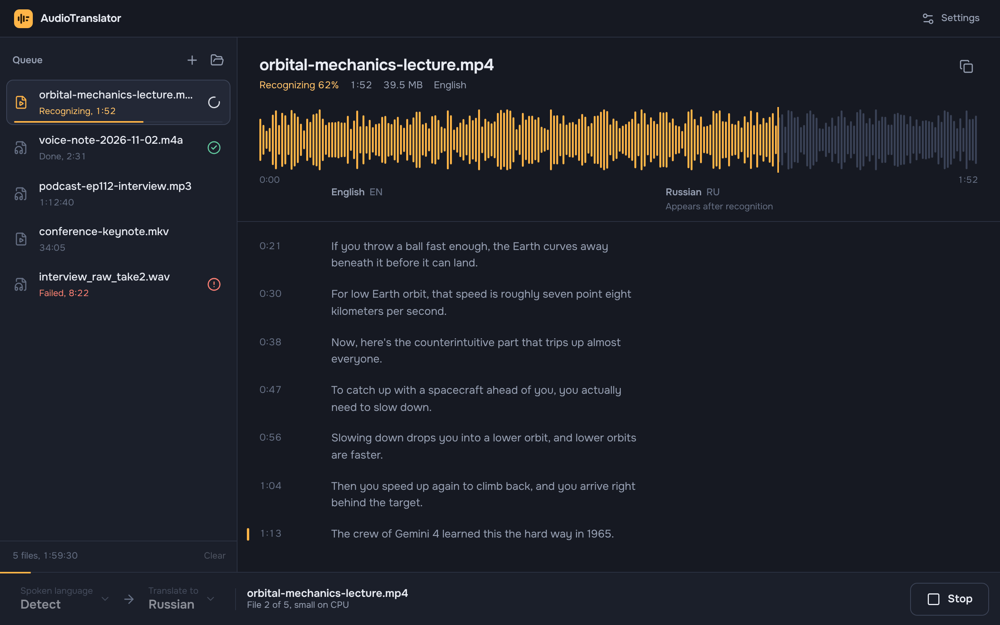
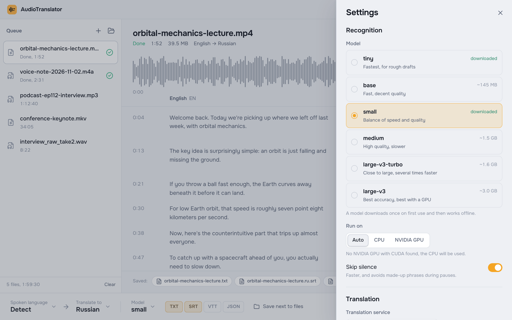

<div align="center">


# AudioTranslator

**Turn speech in audio and video files into text, subtitles and translations.**<br>
Recognition runs on your own computer with Whisper. Drop in a file or a whole folder and get readable text and ready-to-use `.srt` subtitles in another language.

[](https://github.com/wissxi/AudioTranslator/releases/latest)
[](https://github.com/wissxi/AudioTranslator/actions/workflows/ci.yml)
[](https://github.com/wissxi/AudioTranslator/actions/workflows/build.yml)

[](LICENSE)

**English** | [Русский](README.ru.md)



</div>

## What it does

- **Works with what you already have.** MP3, WAV, M4A, FLAC, OGG, OPUS, MP4, MKV, MOV, AVI, WEBM and more — drop single files or entire folders. Nothing else to install: audio decoding is built in.
- **Recognizes speech locally.** [faster-whisper](https://github.com/SYSTRAN/faster-whisper) runs the Whisper models on your CPU or NVIDIA GPU. Your audio never leaves the computer.
- **Detects the language by itself** and translates into any of 45 languages through Google Translate (free), DeepL (API key) or MyMemory. If a service fails, the next one takes over.
- **Shows the work as it happens.** Text appears line by line while the file is processed, the waveform fills in as recognition moves forward, and hovering a line shows where it sits in the recording.
- **Saves what you need:** text with paragraphs, SRT and VTT subtitles (translated and original), JSON with timings, and one combined report for the whole batch.
- **Feels like a desktop app:** a native window, Russian and English interface, light and dark themes, keyboard shortcuts.

<table>
  <tr>
    <td width="50%"></td>
    <td width="50%"></td>
  </tr>
  <tr>
    <td align="center"><sub>Live recognition</sub></td>
    <td align="center"><sub>Settings, light theme</sub></td>
  </tr>
</table>

## Download

**Windows 10 and 11 (64-bit):** grab the latest release from the [Releases page](https://github.com/wissxi/AudioTranslator/releases/latest).

| File | When to use it |
| --- | --- |
| `AudioTranslator-<version>-setup.exe` | Regular installation with a Start menu shortcut. No admin rights needed. |
| `AudioTranslator-<version>-windows-x64-portable.zip` | Unzip anywhere and run `AudioTranslator.exe`. |

On first use the app downloads the selected Whisper model once (the default `small` is about 485 MB). After that, recognition works offline.

> [!NOTE]
> The window uses Microsoft Edge WebView2, which is part of Windows 11 and up-to-date Windows 10. If it is missing, the app says so and opens the [download page](https://developer.microsoft.com/microsoft-edge/webview2/).
> The app is not code-signed yet, so Windows SmartScreen may warn about it: choose **More info → Run anyway**.

## How to use

1. Drag audio or video files (or a folder) into the window, or press <kbd>Ctrl</kbd>+<kbd>O</kbd>.
2. In the bar at the bottom pick the spoken language (or leave **Detect**) and the language to translate into.
3. Press **Transcribe & translate**. Results are saved next to the original files, or in the folder you choose in Settings.

| Shortcut | Action |
| --- | --- |
| <kbd>Ctrl</kbd>+<kbd>O</kbd> | Add files |
| <kbd>Ctrl</kbd>+<kbd>Shift</kbd>+<kbd>O</kbd> | Add a folder |
| <kbd>Ctrl</kbd>+<kbd>Enter</kbd> | Start or stop |
| <kbd>Ctrl</kbd>+<kbd>,</kbd> | Settings |
| <kbd>Delete</kbd> | Remove the selected file from the queue |

### What you get

For `lecture.mp4` translated from English into Russian, with TXT and SRT selected:

```text
lecture.mp4
lecture.txt          original and translation, split into paragraphs
lecture.ru.srt       translated subtitles
lecture.en.srt       original subtitles
translations.txt     every file of the batch in one report
```

A real result for the 11-second sample in [`tests/data/jfk.mp3`](tests/data/jfk.mp3):

```srt
1
00:00:00,000 --> 00:00:11,000
И поэтому, мои соотечественники-американцы, не спрашивайте, что ваша страна может сделать для вас, спросите, что вы можете сделать для своей страны.
```

## Models

Pick the model in **Settings → Recognition**. Each one downloads on first use.

| Model | Download | Speed | Accuracy | Good for |
| --- | ---: | :---: | :---: | --- |
| `tiny` | 75 MB | ●●●●● | ●○○○○ | Quick drafts |
| `base` | 145 MB | ●●●●● | ●●○○○ | Clear speech, older computers |
| `small` (default) | 485 MB | ●●●●○ | ●●●○○ | Everyday use on a CPU |
| `medium` | 1.5 GB | ●●○○○ | ●●●●○ | Accents, noisy recordings |
| `large-v3-turbo` | 1.6 GB | ●●●○○ | ●●●●○ | Near-best quality, best with a GPU |
| `large-v3` | 3.1 GB | ●○○○○ | ●●●●● | Maximum accuracy |

The dots are a rough guide; real speed depends on your hardware.

### NVIDIA GPU

With **Run on: Auto** the app uses an NVIDIA GPU when one is available, which is many times faster than a CPU. This needs the CUDA 12 libraries **cuBLAS** and **cuDNN 9**:

- installed with the [CUDA Toolkit 12](https://developer.nvidia.com/cuda-downloads) and [cuDNN 9](https://developer.nvidia.com/cudnn) and added to `PATH`, or
- when running from source: `pip install nvidia-cublas-cu12 "nvidia-cudnn-cu12==9.*"`.

If something is missing, the app falls back to the CPU on its own and keeps working.

## Translation services

| Service | Key | Limits | Notes |
| --- | --- | --- | --- |
| Google Translate | not needed | Heavy use can be rate-limited | Default |
| [DeepL](https://www.deepl.com/pro-api) | API key (Free or Pro) | Free plan: 500,000 characters a month | Most natural wording |
| [MyMemory](https://mymemory.translated.net/) | not needed | About 5,000 characters a day | Backup |

With **Backup service** on (default), a failed translation is retried with the next service. If every service fails, the original text is still saved and the app explains why.

**Privacy:** audio is processed only on your computer. When translation is on, the recognized text is sent to the selected service. Choose **No translation** to keep everything offline.

## Command line

The same engine is available without the window:

```bash
audiotranslator-cli lectures/ -t ru -f txt,srt
audiotranslator-cli interview.m4a --no-translate -m medium -f srt,vtt -o subtitles/
audiotranslator-cli talk.mp4 -t de --provider deepl --deepl-key YOUR_KEY
audiotranslator-cli --list-models
```

`audiotranslator-cli --help` lists every option.

## Run from source

Requires Python 3.10 or newer.

```bash
git clone https://github.com/wissxi/AudioTranslator.git
cd AudioTranslator
python -m venv .venv
```

Activate the environment with `.venv\Scripts\activate` on Windows or `source .venv/bin/activate` on macOS and Linux, then:

```bash
pip install -e .
audiotranslator
```

On Linux pywebview also needs a GUI toolkit, for example `pip install "pywebview[qt]"`.

## Build the Windows app

```bash
pip install -e ".[build]"
pyinstaller packaging/audiotranslator.spec --noconfirm
```

The app appears in `dist/AudioTranslator/`. To make the installer, run [Inno Setup](https://jrsoftware.org/isinfo.php) on `packaging/installer.iss`. GitHub Actions does all of this on every push and publishes a release for every `v*` tag.

## Project structure

```text
src/audiotranslator/
├── app.py            native window and the bridge between Python and the interface
├── cli.py            command-line interface
├── settings.py       user settings (JSON in the app data folder)
├── languages.py      supported languages
├── core/
│   ├── media.py        finding files, decoding audio, waveform
│   ├── transcriber.py  Whisper models: download, GPU/CPU, recognition
│   ├── translation.py  Google / DeepL / MyMemory with batching and fallback
│   ├── exporters.py    TXT, SRT, VTT, JSON and the combined report
│   └── pipeline.py     runs a batch and reports progress as events
└── web/              the interface: HTML, CSS, JavaScript, fonts
tests/                pytest suite (fake engine) + a real Whisper test (--slow)
packaging/            PyInstaller spec and Inno Setup installer
```

## Development

```bash
pip install -e ".[dev]"
python -m pytest              # fast tests
python -m pytest --slow       # also downloads Whisper tiny and recognizes a real recording
ruff check src tests && ruff format src tests
```

The interface can be worked on in a regular browser with a simulated backend:

```bash
python -m http.server 8000 -d src/audiotranslator/web
```

Then open <http://localhost:8000/?demo> (also `?demo=processing`, `?demo=done`, `&lang=en`, `&theme=light`). Set `AUDIOTRANSLATOR_DEBUG=1` to open the developer tools in the app window.

See [CONTRIBUTING.md](CONTRIBUTING.md) for details.

## Troubleshooting

<details>
<summary><b>Translation failed, but the text is there</b></summary>

The translation service limited requests or was unreachable. The original text and subtitles are saved anyway. Try again later, switch the service in Settings, or use a DeepL key.
</details>

<details>
<summary><b>The model download is slow or fails</b></summary>

Models come from Hugging Face. Check the connection and start again; an interrupted download continues where it stopped. Models are stored in `%LOCALAPPDATA%\AudioTranslator\models` (Settings → About → Models folder).
</details>

<details>
<summary><b>The text has repeated or invented phrases</b></summary>

Keep **Skip silence** on (default) and try a larger model. Very noisy recordings benefit most from `medium` or `large-v3-turbo`.
</details>

<details>
<summary><b>Where are the settings and logs?</b></summary>

`%LOCALAPPDATA%\AudioTranslator` on Windows, `~/Library/Application Support/AudioTranslator` on macOS, `~/.local/share/audiotranslator` on Linux. Attach `audiotranslator.log` when you [report a problem](https://github.com/wissxi/AudioTranslator/issues/new/choose).
</details>

## Roadmap

- [ ] Play the recording with the current subtitle highlighted
- [ ] Edit lines before saving
- [ ] Speaker labels
- [ ] Offline translation
- [ ] Ready-made builds for macOS and Linux

## Thanks

[OpenAI Whisper](https://github.com/openai/whisper) · [faster-whisper](https://github.com/SYSTRAN/faster-whisper) · [CTranslate2](https://github.com/OpenNMT/CTranslate2) · [PyAV](https://github.com/PyAV-Org/PyAV) · [pywebview](https://github.com/r0x0r/pywebview) · [deep-translator](https://github.com/nidhaloff/deep-translator) · [Onest font](https://github.com/simpals/onest) · [Lucide icons](https://lucide.dev). See [THIRD_PARTY_NOTICES.md](THIRD_PARTY_NOTICES.md).

## License

[MIT](LICENSE) © wissxi
