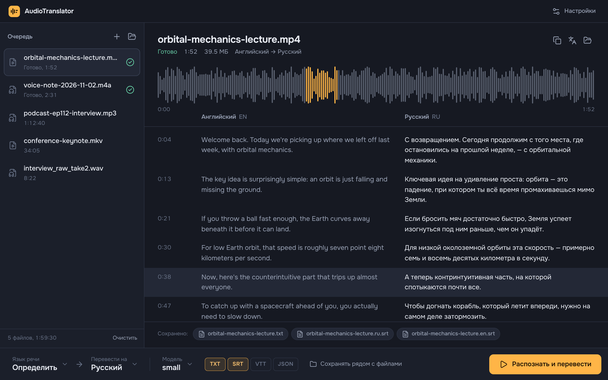
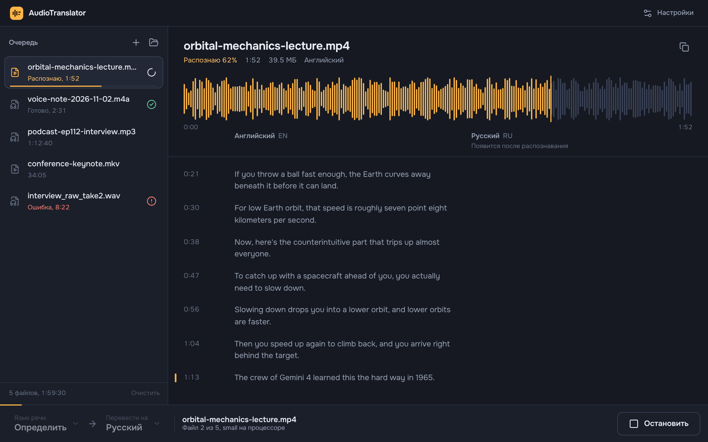
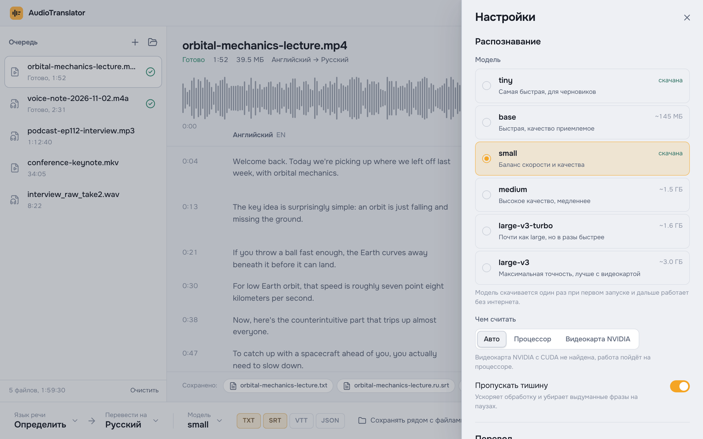

<div align="center">


# AudioTranslator

**Превращает речь из аудио и видео в текст, субтитры и перевод.**<br>
Распознавание работает на вашем компьютере с помощью Whisper. Перетащите файл или целую папку — и получите читаемый текст и готовые субтитры `.srt` на другом языке.

[](https://github.com/wissxi/AudioTranslator/releases/latest)
[](https://github.com/wissxi/AudioTranslator/actions/workflows/ci.yml)
[](https://github.com/wissxi/AudioTranslator/actions/workflows/build.yml)

[](LICENSE)

[English](README.md) | **Русский**



</div>

## Что умеет

- **Работает с тем, что у вас уже есть.** MP3, WAV, M4A, FLAC, OGG, OPUS, MP4, MKV, MOV, AVI, WEBM и другие — по одному файлу или целыми папками. Ничего доустанавливать не нужно: декодирование звука встроено.
- **Распознаёт речь локально.** [faster-whisper](https://github.com/SYSTRAN/faster-whisper) запускает модели Whisper на процессоре или видеокарте NVIDIA. Звук не покидает компьютер.
- **Сам определяет язык** и переводит на любой из 45 языков через Google Переводчик (бесплатно), DeepL (нужен ключ API) или MyMemory. Если сервис не отвечает, подключается следующий.
- **Показывает работу в реальном времени.** Текст появляется строка за строкой, волна заполняется по мере распознавания, а при наведении на строку видно, где она звучит в записи.
- **Сохраняет то, что нужно:** текст по абзацам, субтитры SRT и VTT (перевод и оригинал), JSON с таймкодами и общий отчёт по всем файлам.
- **Ощущается как настоящее приложение:** нативное окно, интерфейс на русском и английском, светлая и тёмная темы, горячие клавиши.

<table>
  <tr>
    <td width="50%"></td>
    <td width="50%"></td>
  </tr>
  <tr>
    <td align="center"><sub>Распознавание в реальном времени</sub></td>
    <td align="center"><sub>Настройки, светлая тема</sub></td>
  </tr>
</table>

## Скачать

**Windows 10 и 11 (64-бит):** последняя версия на [странице релизов](https://github.com/wissxi/AudioTranslator/releases/latest).

| Файл | Когда выбирать |
| --- | --- |
| `AudioTranslator-<версия>-setup.exe` | Обычная установка с ярлыком в меню «Пуск». Права администратора не нужны. |
| `AudioTranslator-<версия>-windows-x64-portable.zip` | Распакуйте куда угодно и запустите `AudioTranslator.exe`. |

При первом запуске приложение один раз скачивает выбранную модель Whisper (по умолчанию `small`, около 485 МБ). Дальше распознавание работает без интернета.

> [!NOTE]
> Окно работает на Microsoft Edge WebView2 — он есть в Windows 11 и в обновлённой Windows 10. Если его нет, приложение сообщит об этом и откроет [страницу загрузки](https://developer.microsoft.com/microsoft-edge/webview2/).
> Приложение пока не подписано сертификатом, поэтому SmartScreen может предупредить: нажмите **Подробнее → Выполнить в любом случае**.

## Как пользоваться

1. Перетащите в окно аудио или видео (или папку) либо нажмите <kbd>Ctrl</kbd>+<kbd>O</kbd>.
2. Внизу выберите язык речи (или оставьте **Определить**) и язык перевода.
3. Нажмите **Распознать и перевести**. Результаты сохранятся рядом с исходными файлами или в папку, выбранную в настройках.

| Клавиши | Действие |
| --- | --- |
| <kbd>Ctrl</kbd>+<kbd>O</kbd> | Добавить файлы |
| <kbd>Ctrl</kbd>+<kbd>Shift</kbd>+<kbd>O</kbd> | Добавить папку |
| <kbd>Ctrl</kbd>+<kbd>Enter</kbd> | Начать или остановить |
| <kbd>Ctrl</kbd>+<kbd>,</kbd> | Настройки |
| <kbd>Delete</kbd> | Убрать выбранный файл из очереди |

### Что получится

Для `lecture.mp4` с переводом с английского на русский и выбранными TXT и SRT:

```text
lecture.mp4
lecture.txt          оригинал и перевод, разбитые на абзацы
lecture.ru.srt       субтитры с переводом
lecture.en.srt       субтитры на языке оригинала
translations.txt     все файлы пакета в одном отчёте
```

Настоящий результат для 11-секундного примера [`tests/data/jfk.mp3`](tests/data/jfk.mp3):

```srt
1
00:00:00,000 --> 00:00:11,000
И поэтому, мои соотечественники-американцы, не спрашивайте, что ваша страна может сделать для вас, спросите, что вы можете сделать для своей страны.
```

## Модели

Модель выбирается в **Настройки → Распознавание** и скачивается при первом использовании.

| Модель | Размер | Скорость | Точность | Для чего |
| --- | ---: | :---: | :---: | --- |
| `tiny` | 75 МБ | ●●●●● | ●○○○○ | Быстрые черновики |
| `base` | 145 МБ | ●●●●● | ●●○○○ | Чёткая речь, слабые компьютеры |
| `small` (по умолчанию) | 485 МБ | ●●●●○ | ●●●○○ | Повседневная работа на процессоре |
| `medium` | 1,5 ГБ | ●●○○○ | ●●●●○ | Акценты, шумные записи |
| `large-v3-turbo` | 1,6 ГБ | ●●●○○ | ●●●●○ | Почти максимальное качество, лучше с видеокартой |
| `large-v3` | 3,1 ГБ | ●○○○○ | ●●●●● | Максимальная точность |

Точки — ориентир; реальная скорость зависит от компьютера.

### Видеокарта NVIDIA

В режиме **Чем считать: Авто** приложение само использует видеокарту NVIDIA, если она есть, — это в разы быстрее процессора. Нужны библиотеки CUDA 12 **cuBLAS** и **cuDNN 9**:

- установленные вместе с [CUDA Toolkit 12](https://developer.nvidia.com/cuda-downloads) и [cuDNN 9](https://developer.nvidia.com/cudnn) и добавленные в `PATH`, или
- при запуске из исходников: `pip install nvidia-cublas-cu12 "nvidia-cudnn-cu12==9.*"`.

Если чего-то не хватает, приложение само переключится на процессор и продолжит работу.

## Сервисы перевода

| Сервис | Ключ | Ограничения | Примечание |
| --- | --- | --- | --- |
| Google Переводчик | не нужен | При активном использовании может ограничивать запросы | По умолчанию |
| [DeepL](https://www.deepl.com/pro-api) | ключ API (Free или Pro) | Бесплатно — 500 000 символов в месяц | Самый естественный перевод |
| [MyMemory](https://mymemory.translated.net/) | не нужен | Около 5000 символов в день | Запасной |

С включённой **Подстраховкой** (по умолчанию) неудачный перевод повторяется через следующий сервис. Если не сработал ни один, оригинальный текст всё равно сохраняется, а приложение объясняет причину.

**Приватность:** звук обрабатывается только на вашем компьютере. Если перевод включён, распознанный текст отправляется выбранному сервису. Выберите **Без перевода**, чтобы всё оставалось офлайн.

## Командная строка

Тот же движок доступен без окна:

```bash
audiotranslator-cli lectures/ -t ru -f txt,srt
audiotranslator-cli interview.m4a --no-translate -m medium -f srt,vtt -o subtitles/
audiotranslator-cli talk.mp4 -t de --provider deepl --deepl-key ВАШ_КЛЮЧ
audiotranslator-cli --list-models
```

Все параметры: `audiotranslator-cli --help`.

## Запуск из исходников

Нужен Python 3.10 или новее.

```bash
git clone https://github.com/wissxi/AudioTranslator.git
cd AudioTranslator
python -m venv .venv
```

Активируйте окружение: `.venv\Scripts\activate` в Windows или `source .venv/bin/activate` в macOS и Linux. Затем:

```bash
pip install -e .
audiotranslator
```

В Linux для окна pywebview нужен графический тулкит, например `pip install "pywebview[qt]"`.

## Сборка приложения для Windows

```bash
pip install -e ".[build]"
pyinstaller packaging/audiotranslator.spec --noconfirm
```

Готовое приложение появится в `dist/AudioTranslator/`. Установщик собирается через [Inno Setup](https://jrsoftware.org/isinfo.php) из `packaging/installer.iss`. GitHub Actions делает всё это при каждом пуше и публикует релиз для каждого тега `v*`.

## Структура проекта

```text
src/audiotranslator/
├── app.py            нативное окно и мост между Python и интерфейсом
├── cli.py            командная строка
├── settings.py       настройки пользователя (JSON в папке приложения)
├── languages.py      поддерживаемые языки
├── core/
│   ├── media.py        поиск файлов, декодирование звука, волна
│   ├── transcriber.py  модели Whisper: загрузка, GPU/CPU, распознавание
│   ├── translation.py  Google / DeepL / MyMemory с пакетами и подстраховкой
│   ├── exporters.py    TXT, SRT, VTT, JSON и общий отчёт
│   └── pipeline.py     обработка пакета и события о прогрессе
└── web/              интерфейс: HTML, CSS, JavaScript, шрифты
tests/                тесты pytest (с подменой движка) + настоящий тест Whisper (--slow)
packaging/            PyInstaller и установщик Inno Setup
```

## Разработка

```bash
pip install -e ".[dev]"
python -m pytest              # быстрые тесты
python -m pytest --slow       # ещё и скачивает Whisper tiny и распознаёт настоящую запись
ruff check src tests && ruff format src tests
```

Интерфейс можно дорабатывать в обычном браузере с имитацией движка:

```bash
python -m http.server 8000 -d src/audiotranslator/web
```

Откройте <http://localhost:8000/?demo> (а также `?demo=processing`, `?demo=done`, `&lang=en`, `&theme=light`). Переменная `AUDIOTRANSLATOR_DEBUG=1` включает инструменты разработчика в окне приложения.

Подробнее — в [CONTRIBUTING.md](CONTRIBUTING.md).

## Частые вопросы

<details>
<summary><b>Перевод не выполнен, но текст есть</b></summary>

Сервис перевода ограничил запросы или был недоступен. Оригинальный текст и субтитры всё равно сохранены. Попробуйте позже, выберите другой сервис в настройках или подключите ключ DeepL.
</details>

<details>
<summary><b>Модель скачивается медленно или не скачивается</b></summary>

Модели загружаются с Hugging Face. Проверьте подключение и запустите снова — прерванная загрузка продолжится с того же места. Модели лежат в `%LOCALAPPDATA%\AudioTranslator\models` (Настройки → О программе → Папка с моделями).
</details>

<details>
<summary><b>В тексте повторяются или появляются выдуманные фразы</b></summary>

Оставьте включённым **Пропускать тишину** (по умолчанию) и попробуйте модель побольше. Для шумных записей лучше всего `medium` или `large-v3-turbo`.
</details>

<details>
<summary><b>Где настройки и логи?</b></summary>

`%LOCALAPPDATA%\AudioTranslator` в Windows, `~/Library/Application Support/AudioTranslator` в macOS, `~/.local/share/audiotranslator` в Linux. Приложите `audiotranslator.log`, когда [сообщаете о проблеме](https://github.com/wissxi/AudioTranslator/issues/new/choose).
</details>

## Планы

- [ ] Воспроизведение записи с подсветкой текущей строки
- [ ] Правка строк перед сохранением
- [ ] Разметка говорящих
- [ ] Офлайн-перевод
- [ ] Готовые сборки для macOS и Linux

## Благодарности

[OpenAI Whisper](https://github.com/openai/whisper) · [faster-whisper](https://github.com/SYSTRAN/faster-whisper) · [CTranslate2](https://github.com/OpenNMT/CTranslate2) · [PyAV](https://github.com/PyAV-Org/PyAV) · [pywebview](https://github.com/r0x0r/pywebview) · [deep-translator](https://github.com/nidhaloff/deep-translator) · [шрифт Onest](https://github.com/simpals/onest) · [иконки Lucide](https://lucide.dev). Подробнее — в [THIRD_PARTY_NOTICES.md](THIRD_PARTY_NOTICES.md).

## Лицензия

[MIT](LICENSE) © wissxi
